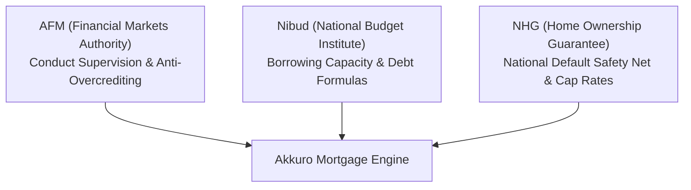
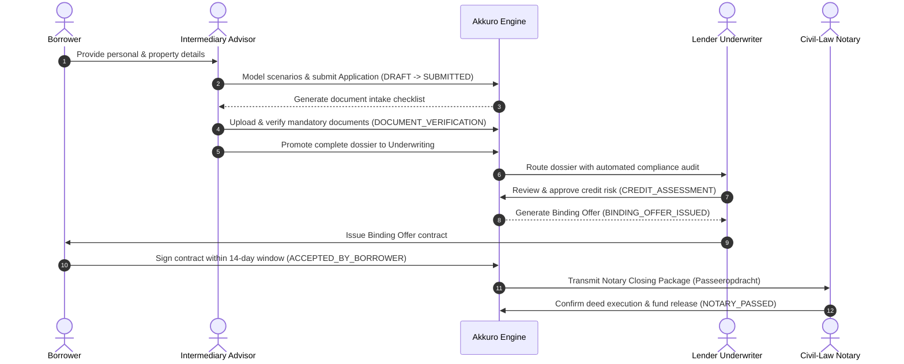
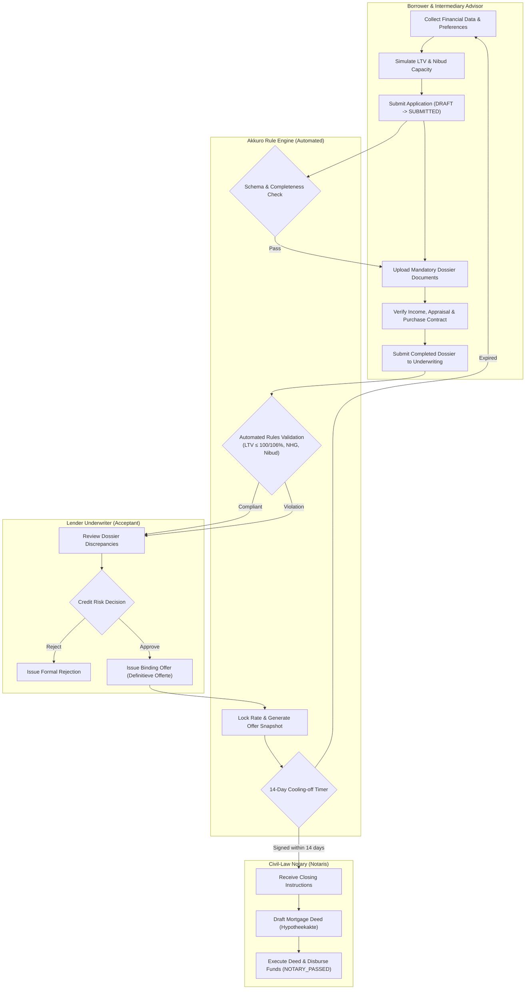
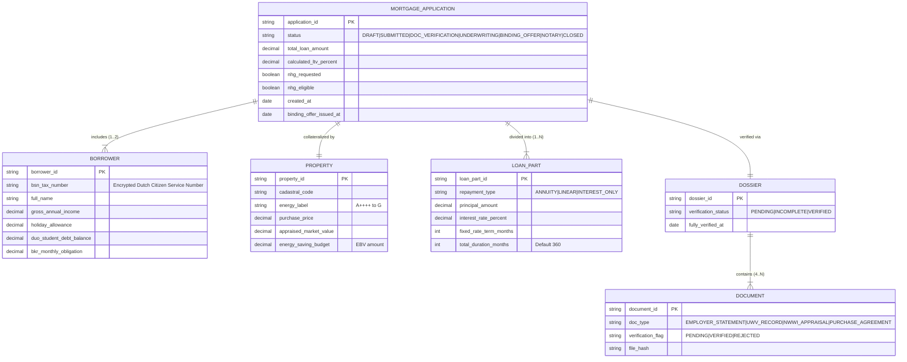

# Functional Specification Document (FSD)
# Akkuro Mortgage Platform — Loan Origination System (LOS)

**Product:** Akkuro Mortgage Platform  
**Document Type:** Independent Domain Research & Conceptual Specification Baseline  
**Data Sources:** Public Dutch Statutory Regulations (AFM Directives, Nibud 2024/2025 Standards, NHG Terms, Wft) & Open Web Research  
**Target Organization:** Topicus Vietnam (TSS / Constellation Software)  
**Standard:** Living Documentation / Agile Requirements Engineering (AFM, Nibud, NHG)  
**Author:** Senior Business Analyst Candidate  
**Version:** 1.0.0 (Comprehensive Baseline)  
**Date:** 2026-10-10  

> [!NOTE]
> **Independent Research & Portfolio Disclaimer:** This specification is an independent analytical research project developed for technical demonstration and portfolio evaluation. All business rules, calculation models, and lifecycle state machines were synthesized exclusively from publicly accessible regulatory sources (AFM supervisory directives, Nibud statutory borrowing capacity tables, NHG guarantee criteria, and Dutch Civil Code/Wft regulations) and open industry research. No proprietary or confidential information of Topicus or third-party institutions is used.

---

## Table of Contents

- [Chapter 1: Business Domain & Regulatory Framework](#chapter-1-business-domain--regulatory-framework)
  - [1.1 Market Context & Intermediary Distribution](#11-market-context--intermediary-distribution)
  - [1.2 Regulatory & Supervisory Bodies (AFM, Nibud, NHG)](#12-regulatory--supervisory-bodies-afm-nibud-nhg)
  - [1.3 Stakeholder Personas & Value Proposition](#13-stakeholder-personas--value-proposition)
  - [1.4 Standardized Dutch Mortgage Glossary](#14-standardized-dutch-mortgage-glossary)
- [Chapter 2: Process Architecture & Workflow Modeling](#chapter-2-process-architecture--workflow-modeling)
  - [2.1 End-to-End Sequence Diagram](#21-end-to-end-sequence-diagram)
  - [2.2 BPMN 2.0 Origination Swimlanes](#22-bpmn-20-origination-swimlanes)
  - [2.3 State Transition Matrix & Guard Conditions](#23-state-transition-matrix--guard-conditions)
  - [2.4 Role-Based Access Control (RBAC) & Four-Eyes Principle](#24-role-based-access-control-rbac--four-eyes-principle)
- [Chapter 3: Functional Requirements & User Stories](#chapter-3-functional-requirements--user-stories)
  - [3.1 Requirements Breakdown Structure (5 Epics / 5 Stages)](#31-requirements-breakdown-structure-5-epics--5-stages)
  - [3.2 Epic 01: Loan Scenario Modeling & Application Intake](#32-epic-01-loan-scenario-modeling--application-intake)
  - [3.3 Epic 02: Dossier Intake & Document Verification](#33-epic-02-dossier-intake--document-verification)
  - [3.4 Epic 03: Credit Assessment & Compliance Gating](#34-epic-03-credit-assessment--compliance-gating)
  - [3.5 Epic 04: Binding Offer Issuance & Statutory Reflection](#35-epic-04-binding-offer-issuance--statutory-reflection)
  - [3.6 Epic 05: Notary Closing Instructions & Fund Settlement](#36-epic-05-notary-closing-instructions--fund-settlement)
- [Chapter 4: Data Architecture & Domain Model](#chapter-4-data-architecture--domain-model)
  - [4.1 Conceptual Entity-Relationship Diagram (ERD)](#41-conceptual-entity-relationship-diagram-erd)
  - [4.2 Standardized Data Dictionary (6 Core Entities)](#42-standardized-data-dictionary-6-core-entities)
- [Chapter 5: Business Rules & Financial Calculation Matrix](#chapter-5-business-rules--financial-calculation-matrix)
  - [5.1 Statutory Loan-to-Value (LTV) Rules](#51-statutory-loan-to-value-ltv-rules)
  - [5.2 National Mortgage Guarantee (NHG) Decision Matrix](#52-national-mortgage-guarantee-nhg-decision-matrix)
  - [5.3 Nibud Borrowing Capacity & Debt Deduction Rules](#53-nibud-borrowing-capacity--debt-deduction-rules)
  - [5.4 Dossier Verification & Lifecycle Gates](#54-dossier-verification--lifecycle-gates)
  - [5.5 Binding Offer & Notary Settlement Rules](#55-binding-offer--notary-settlement-rules)
  - [5.6 Repayment Amortization Formulas (Annuity vs. Linear)](#56-repayment-amortization-formulas-annuity-vs-linear)

---

## Chapter 1: Business Domain & Regulatory Framework

### 1.1 Market Context & Intermediary Distribution
The Dutch residential mortgage ecosystem relies heavily on third-party distribution: over **75% of mortgages in the Netherlands** are originated through independent financial intermediaries (*Hypotheekadviseurs*) rather than direct bank branch networks. Intermediaries evaluate multi-lender scenarios, gather compliance dossiers, and submit structured loan payloads to funding lenders (retail banks, pension funds, and insurance syndicates).

The **Akkuro Mortgage Platform** provides a modern, cloud-native Loan Origination System (LOS) that connects intermediaries, lenders, underwriters, and civil-law notaries into a unified, compliance-gated origination pipeline.

### 1.2 Regulatory & Supervisory Bodies (AFM, Nibud, NHG)
Every business rule, validation gate, and data field in this specification adheres to three statutory bodies:



1. **AFM (Autoriteit Financiële Markten):** Financial conduct supervisor. Enforces consumer protection laws (*Wft*), anti-overcrediting rules, and the statutory 14-day reflection window.
2. **Nibud (Nationaal Instituut voor Budgetvoorlichting):** Publishes statutory maximum debt-to-income tables and defines monthly burden deductions for consumer debt (BKR) and student loans (DUO).
3. **NHG (Nationale Hypotheek Garantie):** Government-backed mortgage default guarantee operated by WEW. Limits risk for lenders and provides interest discounts (typically -0.20% to -0.40%) for qualifying loans up to €435,000 (€461,100 with energy improvements).

### 1.3 Stakeholder Personas & Value Proposition

| Persona | Role | Primary Workflow Need | Pain Point Addressed |
|---|---|---|---|
| **Borrower** (*Klant*) | Consumer applying for financing | Transparent status tracking, digital document upload, fast offer turnaround. | Opaque underwriting stages and repetitive document requests. |
| **Intermediary Advisor** (*Hypotheekadviseur*) | Certified mortgage broker | Multi-scenario loan modeling, automated dossier validation, instant intake routing. | Manual document verification and back-and-forth email loops with underwriters. |
| **Lender Underwriter** (*Acceptant*) | Credit risk decision-maker | Automated statutory compliance gating, auditable risk calculations, one-click offer generation. | Re-keying data between disparate banking systems and manual LTV/NHG validation. |
| **Civil-Law Notary** (*Notaris*) | Legal closing officer | Tamper-proof deed instructions (*Passeeropdracht*), automated fund reconciliation. | Delayed escrow disbursements and unverified last-minute contract amendments. |

### 1.4 Standardized Dutch Mortgage Glossary

| Dutch Term | Standard English Concept | Definition & BA Significance |
|---|---|---|
| **Aanvraag** | Mortgage Application | The core case dossier containing borrower financials, property data, and loan requests. |
| **Taxatiewaarde** | Appraised Market Value | Independent NWWI valuation used as statutory denominator for Loan-to-Value (LTV). |
| **Koopsom** | Purchase Price | Contractual price agreed in the provisional purchase agreement (*Koopovereenkomst*). |
| **LTV** | Loan-to-Value Ratio | Loan principal expressed as percentage of appraised value (max 100% standard, 106% with EBV). |
| **EBV** | Energy-Saving Budget | Additional financing (up to 6% above property value) dedicated strictly to sustainable renovations. |
| **Borgtochtprovisie** | NHG Guarantee Fee | Statutory 0.6% one-time fee paid at notary closing for NHG risk coverage. |
| **Hypotheekvormen** | Mortgage Repayment Types | Annuity (*Annuïteit*), Linear (*Lineair*), or Interest-Only (*Aflossingsvrij* - capped at 50% LTV). |
| **Renteaanbod** | Indicative Rate Offer | Preliminary interest rate proposal locking the rate during document intake. |
| **Definitieve Offerte** | Binding Mortgage Offer | Final legally binding contract issued post-underwriting; triggers 14-day statutory reflection. |
| **Passeerdatum** | Closing / Execution Date | Scheduled legal closing date where the deed is signed and funds are disbursed by the notary. |

---

## Chapter 2: Process Architecture & Workflow Modeling

### 2.1 End-to-End Sequence Diagram



### 2.2 BPMN 2.0 Origination Swimlanes



### 2.3 State Transition Matrix & Guard Conditions

| From State | To State | Trigger Event | Allowed Actor(s) | Guard Condition / Validation Gate |
|---|---|---|---|---|
| `DRAFT` | `SUBMITTED` | Submit Application | Borrower, Advisor | All mandatory applicant, income, and property fields populated (`BR-STATE-01`). |
| `SUBMITTED` | `DOCUMENT_VERIFICATION` | Intake Routing | Advisor, System | Automated schema and initial anti-fraud checks passed (`BR-STATE-01b`). |
| `DOCUMENT_VERIFICATION` | `CREDIT_ASSESSMENT` | Dossier Verified | Advisor | 4 mandatory documents marked `VERIFIED` (`BR-DOC-01`, `BR-STATE-02`). |
| `CREDIT_ASSESSMENT` | `BINDING_OFFER_ISSUED` | Underwriting Approval | Underwriter | LTV $\le$ cap, requested loan $\le$ Nibud capacity, NHG rules validated (`BR-STATE-03`). |
| `CREDIT_ASSESSMENT` | `REJECTED` | Underwriting Rejection | Underwriter | Statutory violation or credit risk threshold breached. Reason logged (`BR-LTV-02`, `BR-LTV-04`). |
| `BINDING_OFFER_ISSUED` | `ACCEPTED_BY_BORROWER` | Offer Acceptance | Borrower | Digital signature completed within 14-day statutory reflection window (`BR-STATE-04`). |
| `BINDING_OFFER_ISSUED` | `EXPIRED` | Reflection Timeout | System | Statutory 14-day window lapsed without borrower signature (`BR-OFFER-02`). |
| `ACCEPTED_BY_BORROWER` | `NOTARY_PASSED` | Deed Execution | Notary | Mortgage deed signed and escrow fund release confirmed (`BR-STATE-05`). |
| *Any Pre-Closing State* | `CANCELLED` | Withdrawal | Borrower, Advisor | Application formally withdrawn by customer prior to deed execution. |

### 2.4 Role-Based Access Control (RBAC) & Four-Eyes Principle

| Action | Borrower (*Klant*) | Advisor (*Adviseur*) | Underwriter (*Acceptant*) | Notary (*Notaris*) |
|---|:---:|:---:|:---:|:---:|
| Initiate Application | ✅ Full | ✅ Full | ❌ None | ❌ None |
| Upload & Verify Documents | ⚠️ Upload only | ✅ Verify & Sign-off | 👁️ Audit only | ❌ None |
| Configure Loan Scenarios | 👁️ View quote | ✅ Configure & Model | 👁️ Review | ❌ None |
| Issue Binding Loan Offer | ❌ Forbidden | ❌ Forbidden | ✅ Exclusive | ❌ None |
| Execute Mortgage Deed | ❌ Forbidden | ❌ Forbidden | ❌ Forbidden | ✅ Exclusive |

---

## Chapter 3: Functional Requirements & User Stories

### 3.1 Requirements Breakdown Structure (5 Epics / 5 Flagship Stories)

```
EPIC-01: Loan Scenario Modeling & Application Intake (Stage 1)
└── US-01: Statutory Borrowing Capacity & Debt-Burden Gating [Applies BR-NIBUD-01..04, BR-CALC-01..02]

EPIC-02: Dossier Intake & Document Verification (Stage 2)
└── US-02: Mandatory 4-Document Intake & Income Verification Gate [Applies BR-DOC-01, BR-DOC-02, BR-STATE-02]

EPIC-03: Credit Assessment & Compliance Gating (Stage 3)
└── US-03: Statutory LTV & NHG Compliance Decision Gate [Applies BR-LTV-01..04, BR-NHG-01..04, BR-STATE-03]

EPIC-04: Binding Offer Issuance & Statutory Reflection (Stage 4)
└── US-04: Immutable Binding Offer Issuance & 14-Day Reflection Window [Applies BR-OFFER-01, BR-OFFER-02, BR-STATE-04]

EPIC-05: Notary Closing Instructions & Fund Settlement (Stage 5)
└── US-05: Notary Closing Package (Passeeropdracht) & Escrow Settlement [Applies BR-NOTARY-01, BR-NOTARY-02, BR-STATE-05]
```

### 3.2 Epic 01: Loan Scenario Modeling & Application Intake

#### US-01: Statutory Borrowing Capacity & Debt-Burden Gating
* **As a:** Mortgage Advisor (*Hypotheekadviseur*)  
* **I want to:** Input applicant gross incomes, interest rate fixing period, and existing debt obligations (DUO student debt, BKR credit lines)  
* **So that:** The system computes the statutory maximum borrowing capacity under AFM/Nibud regulations and models compliant annuity or linear repayment schedules.  
* **Applies Business Rules:** `BR-NIBUD-01`, `BR-NIBUD-02`, `BR-NIBUD-03`, `BR-NIBUD-04`, `BR-CALC-01`, `BR-CALC-02`

```gherkin
Scenario: Compliant capacity calculation with debt deduction
  Given an applicant with gross annual income of €65,000
  And an outstanding DUO student loan with initial balance of €20,000 (SF35 modern system)
  And an active BKR revolving credit facility limit of €2,000
  And a mortgage interest rate of 4.0% with a 10-year fixed term
  When the advisor calculates statutory borrowing capacity
  Then the DUO debt deducts €0.35 per €100 from monthly borrowing capacity (€70.00/month) per BR-NIBUD-02
  And the BKR facility deducts 2.0% of total credit limit from monthly budget (€40.00/month) per BR-NIBUD-03
  And the system outputs the net maximum permissible mortgage amount compliant with AFM anti-overcrediting rules
```

---

### 3.3 Epic 02: Dossier Intake & Document Verification

#### US-02: Mandatory 4-Document Intake & Income Verification Gate
* **As an:** Underwriting Intake Engine / Verification Specialist  
* **I want to:** Validate that all 4 mandatory statutory documents (Employer Statement, UWV Record, NWWI Appraisal, Purchase Agreement) are uploaded and verified without critical discrepancies  
* **So that:** Incomplete or unverified dossiers are strictly blocked from consuming lender underwriting capacity.  
* **Applies Business Rules:** `BR-DOC-01`, `BR-DOC-02`, `BR-STATE-02`

```gherkin
Scenario: Blocking incomplete dossier from advancing to underwriting
  Given a mortgage application in "DOCUMENT_VERIFICATION" status
  And the Employer Statement, UWV Record, and Purchase Agreement are marked "VERIFIED"
  But the NWWI Appraisal Report is missing or in "PENDING_UPLOAD" status
  When the advisor attempts to submit the dossier to Credit Assessment
  Then the system blocks the transition with error "DOSSIER_INCOMPLETE: Appraisal Report missing" per BR-DOC-01
  And the application state remains locked in "DOCUMENT_VERIFICATION"

Scenario: Income discrepancy reconciliation
  Given a verified UWV Insurance record showing 12-month earnings of €68,000 against self-reported salary of €75,000
  When the income variance exceeds 5.0%
  Then the system flags "CRITICAL_DISCREPANCY" per BR-DOC-02
  And requires an Employer Explanation Letter before verification sign-off is permitted
```

---

### 3.4 Epic 03: Credit Assessment & Compliance Gating

#### US-03: Statutory LTV & NHG Compliance Decision Gate
* **As a:** Lender Underwriter (*Acceptant*)  
* **I want to:** Automatically validate requested loan amounts against statutory LTV ceilings (100% standard vs. 106% with Energy Budget) and NHG guarantee eligibility criteria  
* **So that:** I can issue a compliant approval or formal statutory rejection with full regulatory auditability.  
* **Applies Business Rules:** `BR-LTV-01`, `BR-LTV-02`, `BR-LTV-03`, `BR-LTV-04`, `BR-NHG-01..04`, `BR-STATE-03`

```gherkin
Scenario: Compliant sustainable purchase with 106% LTV
  Given a property with appraised market value of €400,000
  And certified energy-saving measures (EBV) of €20,000
  When the applicant requests a total loan amount of €420,000 (LTV = 105.0%)
  Then the underwriting engine marks LTV as compliant (<= 106.0%) per BR-LTV-03
  And automatically allocates €20,000 into a designated construction deposit (Bouwdepot)

Scenario: Underwriter issues formal rejection on non-compliant loan
  Given a requested loan amount of €450,000 exceeding statutory Nibud borrowing capacity
  When the underwriter reviews the audit scorecard and triggers "Reject Application"
  Then the application transitions to terminal state "REJECTED"
  And the system logs the statutory violation reason in the immutable audit ledger
```

---

### 3.5 Epic 04: Binding Offer Issuance & Statutory Reflection

#### US-04: Immutable Binding Offer Issuance & 14-Day Reflection Window
* **As a:** Compliance Officer / Borrower (*Klant*)  
* **I want to:** Generate an immutable binding mortgage contract (*Definitieve Offerte*) and enforce the statutory 14-calendar-day reflection period (*Bedenktijd*)  
* **So that:** The borrower can execute a legally protected digital acceptance or allow the offer to expire without penalty.  
* **Applies Business Rules:** `BR-OFFER-01`, `BR-OFFER-02`, `BR-STATE-04`

```gherkin
Scenario: Borrower accepts binding offer within statutory window
  Given a binding offer issued on Day 1 with a 14-calendar-day reflection timer per BR-OFFER-02
  When the borrower electronically signs the acceptance on Day 7
  Then the application status transitions to "ACCEPTED_BY_BORROWER" per BR-STATE-04
  And the system initiates the civil-law notary closing package workflow

Scenario: Statutory reflection window expires without signature
  Given an active binding offer with Day 14 reflection window elapsed
  When Day 15 arrives without borrower digital signature
  Then the system automatically transitions the offer to "EXPIRED"
  And locks the file, requiring a new underwriting submission if the borrower wishes to proceed
```

---

### 3.6 Epic 05: Notary Closing Instructions & Fund Settlement

#### US-05: Notary Closing Package (Passeeropdracht) & Escrow Settlement
* **As a:** Operations Specialist / Civil-Law Notary (*Notaris*)  
* **I want to:** Transmit structured closing instructions (*Passeeropdracht*) to the notary and reconcile escrow settlement statements (*Afleveringsnota*) upon deed execution  
* **So that:** Mortgage deed execution and bank fund disbursement are synchronized seamlessly without closing escrow deficits.  
* **Applies Business Rules:** `BR-NOTARY-01`, `BR-NOTARY-02`, `BR-STATE-05`

```gherkin
Scenario: Automated notary instruction dispatch and escrow release
  Given an application in "ACCEPTED_BY_BORROWER" status
  When the calendar reaches 10 business days prior to scheduled closing date (Passeerdatum)
  Then the engine transmits the structured Passeeropdracht payload to the notary office per BR-NOTARY-01
  And upon notary confirmation of deed execution (Hypotheekakte), escrow funds are disbursed
  And the application state transitions to "NOTARY_PASSED" (Lifecycle Complete) per BR-STATE-05
```

---

## Chapter 4: Data Architecture & Domain Model

### 4.1 Conceptual Entity-Relationship Diagram (ERD)



### 4.2 Standardized Data Dictionary (6 Core Entities)

#### Entity 1: `MortgageApplication`
| Field Name | Data Type | Constraints | Description & Business Rule |
|---|---|---|---|
| `application_id` | String (UUID) | Primary Key, Non-null | Unique immutable case dossier identifier. |
| `status` | Enum | Valid State Machine enum | Current lifecycle position (`DRAFT`, `SUBMITTED`, `DOC_VERIFICATION`, `UNDERWRITING`, `BINDING_OFFER`, `NOTARY_PASSED`). |
| `total_loan_amount` | Decimal(12,2) | $> 0$ | Aggregate principal across all linked `LOAN_PART` records. |
| `calculated_ltv_percent` | Decimal(5,2) | Must be $\le 100.0$ (or $106.0$ with EBV) | Computed as $(\text{total\_loan\_amount} / \text{appraised\_market\_value}) \times 100$. |
| `nhg_requested` | Boolean | True / False | Flag set by advisor during scenario configuration. |
| `nhg_eligible` | Boolean | Read-only computed | Evaluated against current statutory cap (€435,000 standard / €461,100 EBV). |
| `created_at` | Timestamp | Non-null | Audit creation timestamp. |
| `binding_offer_issued_at` | Timestamp | Nullable | Timestamp when formal offer is issued; initiates 14-day statutory reflection window. |

#### Entity 2: `Borrower`
| Field Name | Data Type | Constraints | Description & Business Rule |
|---|---|---|---|
| `borrower_id` | String (UUID) | Primary Key, Non-null | Unique applicant profile identifier. |
| `bsn_tax_number` | String | AES-256 Encrypted | Dutch Citizen Service Number (*Burgerservicenummer*). Required for BKR credit checks. |
| `full_name` | String | Non-null | Official legal name matching passport / Dutch ID deed. |
| `gross_annual_income` | Decimal(12,2) | $\ge 0$ | Verified annual base compensation from employer statement. |
| `holiday_allowance` | Decimal(12,2) | $\ge 0$ | Statutory 8% holiday payment (*Vakantiegeld*), included in borrowing base. |
| `duo_student_debt_balance` | Decimal(12,2) | $\ge 0$ | Initial registered student loan balance with DUO. |
| `bkr_monthly_obligation` | Decimal(12,2) | $\ge 0$ | Registered consumer credit / private car lease monthly obligation. |

#### Entity 3: `Property`
| Field Name | Data Type | Constraints | Description & Business Rule |
|---|---|---|---|
| `property_id` | String (UUID) | Primary Key, Non-null | Unique real estate collateral record. |
| `purchase_price` | Decimal(12,2) | $> 0$ | Contractual price agreed in the provisional purchase deed (*Koopovereenkomst*). |
| `appraised_market_value` | Decimal(12,2) | $> 0$ | Certified valuation by NWWI accredited valuer (*Taxatiewaarde*). Serves as LTV denominator. |
| `energy_saving_budget` | Decimal(12,2) | $\ge 0$ | Budget allocated for sustainable measures (*EBV*). Capped at max 6% of appraisal value. |
| `energy_label` | String | A++++ through G | Statutory EU/Dutch energy performance classification. |

#### Entity 4: `LoanPart` (Hypotheekdeel)
| Field Name | Data Type | Constraints | Description & Business Rule |
|---|---|---|---|
| `loan_part_id` | String (UUID) | Primary Key, Non-null | Unique sub-loan split identifier. |
| `repayment_type` | Enum | `ANNUITY`, `LINEAR`, `INTEREST_ONLY` | Amortization mechanics. Interest-Only capped at max 50% of market value. |
| `principal_amount` | Decimal(12,2) | $> 0$ | Principal balance allocated to this specific repayment tranche. |
| `interest_rate_percent` | Decimal(5,3) | $> 0.0$ | Agreed annual nominal interest rate. |
| `fixed_rate_term_months` | Integer | Typically 60, 120, 240, 360 | Fixed-rate lock period (*Rente vaste periode*). |
| `total_duration_months` | Integer | Statutory max 360 (30 yrs) | Full amortization term. |

#### Entity 5: `Dossier`
| Field Name | Data Type | Constraints | Description & Business Rule |
|---|---|---|---|
| `dossier_id` | String (UUID) | Primary Key, Non-null | Dossier container grouping all uploaded compliance files. |
| `verification_status` | Enum | `PENDING`, `INCOMPLETE`, `VERIFIED` | Aggregate verification state. Requires all mandatory documents verified. |
| `fully_verified_at` | Timestamp | Nullable | Timestamp of advisor verification sign-off before promoting to Underwriting. |

#### Entity 6: `Document`
| Field Name | Data Type | Constraints | Description & Business Rule |
|---|---|---|---|
| `document_id` | String (UUID) | Primary Key, Non-null | Unique individual file record. |
| `doc_type` | Enum | `EMPLOYER_STATEMENT`, `UWV_RECORD`, `NWWI_APPRAISAL`, `PURCHASE_AGREEMENT` | Category of statutory document. |
| `verification_flag` | Enum | `PENDING`, `VERIFIED`, `REJECTED` | Verification outcome assigned by advisor / intake specialist. |
| `file_hash` | String | SHA-256 | Cryptographic integrity hash ensuring document tamper-proofing. |
| `uploaded_at` | Timestamp | Non-null | Upload audit timestamp. |

---

## Chapter 5: Business Rules & Financial Calculation Matrix

### 5.1 Statutory Loan-to-Value (LTV) Rules

$$\text{LTV} = \left( \frac{\text{Total Requested Principal}}{\text{Appraised Market Value}} \right) \times 100\%$$

| Rule ID | EBV Included? | Max Statutory LTV Cap | Condition / Verification Requirement | Action / System Response |
|---|:---:|:---:|---|---|
| `BR-LTV-01` | No | **100.0%** | Requested loan $\le$ Appraised Market Value | Status = `COMPLIANT`. Normal underwriting proceeds. |
| `BR-LTV-02` | No | **100.0%** | Requested loan $>$ Appraised Market Value | Status = `REJECTED`. Hard stop: LTV violation flag logged. |
| `BR-LTV-03` | Yes | **106.0%** | EBV budget certified $\le$ 6% of Appraised Value | Status = `COMPLIANT`. Excess amount allocated to Construction Deposit (*Bouwdepot*). |
| `BR-LTV-04` | Yes | **106.0%** | Total loan $> 106.0\%$ of Appraised Value | Status = `REJECTED`. Hard stop: EBV ceiling exceeded. |

### 5.2 National Mortgage Guarantee (NHG) Decision Matrix

*Statutory Year: 2024 / 2025*

| Rule ID | Property Value / Purchase Price | Energy Saving Measures? | NHG Eligibility | Mandatory Fee (*Borgtochtprovisie*) | Interest Rate Impact |
|---|---|:---:|:---:|:---:|:---:|
| `BR-NHG-01` | $\le$ €435,000 | No | **Eligible** | $0.6\%$ of Principal | Automatic $-0.35\%$ rate discount |
| `BR-NHG-02` | $>$ €435,000 | No | **Ineligible** | Not applicable | Standard market rate applies |
| `BR-NHG-03` | $\le$ €461,100 | Yes (certified EBV) | **Eligible** | $0.6\%$ of Principal | Automatic $-0.35\%$ rate discount |
| `BR-NHG-04` | $>$ €461,100 | Yes | **Ineligible** | Not applicable | Standard market rate applies |

### 5.3 Nibud Borrowing Capacity & Debt Deduction Rules

| Rule ID | Debt / Obligation Type | Dutch Registry | Statutory Monthly Burden Ratio | Impact on Borrowing Capacity |
|---|---|---|---|---|
| `BR-NIBUD-01` | Base Borrowing Capacity | Nibud Tables | Maximum debt-to-income factor (typically 4.25x – 4.75x gross income depending on rate) | Establishes absolute ceiling on mortgage principal before debt adjustments. |
| `BR-NIBUD-02` | Revolving Consumer Credit | BKR | **2.0%** of total credit facility per month | Directly deducts 2% of credit limit from monthly disposable financing capacity. |
| `BR-NIBUD-03` | Student Loan (Pre-2015 / SF15) | DUO | **0.75%** of initial loan principal per month | High burden reduction due to 15-year repayment horizon. |
| `BR-NIBUD-04` | Student Loan (Post-2015 / SF35) | DUO | **0.35%** of initial loan principal per month | Moderate burden reduction due to 35-year repayment horizon. |

### 5.4 Dossier Verification & Lifecycle Gates

| Rule ID | Rule Name | Gating Logic | System Action |
|---|---|---|---|
| `BR-DOC-01` | Mandatory 4-Document Checklist | All 4 documents (Employer Statement, UWV Record, NWWI Appraisal, Purchase Deed) must be marked `VERIFIED`. | Blocks transition from `DOCUMENT_VERIFICATION` to `CREDIT_ASSESSMENT`. |
| `BR-DOC-02` | Income Discrepancy Tolerance | Self-reported income variance against UWV insurance record must be $\le 5.0\%$. | If variance $> 5.0\%$, flags `CRITICAL_DISCREPANCY` and requires underwriter sign-off. |
| `BR-STATE-01` | Advisor Intake Gate | All required borrower and property fields must pass schema validation. | Allows transition `DRAFT` $\rightarrow$ `SUBMITTED`. |
| `BR-STATE-02` | Underwriting Entry Gate | Dossier status must be `VERIFIED`. | Allows transition `SUBMITTED` $\rightarrow$ `CREDIT_ASSESSMENT`. |
| `BR-STATE-03` | Credit Approval Gate | LTV compliant, loan $\le$ capacity, and underwriter four-eyes approval logged. | Allows transition `CREDIT_ASSESSMENT` $\rightarrow$ `BINDING_OFFER_ISSUED`. |
| `BR-STATE-04` | Offer Acceptance Gate | Borrower digital signature recorded within 14 calendar days. | Allows transition `BINDING_OFFER_ISSUED` $\rightarrow$ `ACCEPTED_BY_BORROWER`. |
| `BR-STATE-05` | Notary Deed Execution Gate | Notary deed executed and escrow fund settlement matched. | Allows transition `ACCEPTED_BY_BORROWER` $\rightarrow$ `NOTARY_PASSED`. |

### 5.5 Binding Offer & Notary Settlement Rules

| Rule ID | Rule Name | Specification | Legal & Audit Impact |
|---|---|---|---|
| `BR-OFFER-01` | Offer Immutability | Once issued, interest rates, monthly schedules, and loan tranches cannot be modified. | SHA-256 payload hash stored in audit ledger; any edit requires formal re-issuance. |
| `BR-OFFER-02` | Statutory Reflection Window | 14 calendar days (*Bedenktijd*) granted to borrower starting day after issuance. | Offer expires automatically on Day 15 if unexecuted; rate lock is revoked. |
| `BR-NOTARY-01` | Closing Instructions Transmission | Structured *Passeeropdracht* must be delivered to notary $\ge 10$ business days prior to closing date (*Passeerdatum*). | Ensures notary has adequate statutory window to draft mortgage deed (*Hypotheekakte*). |
| `BR-NOTARY-02` | Escrow Fund Settlement | Lender releases escrow mortgage funds only after receiving validated settlement statement (*Afleveringsnota*). | Eliminates escrow reconciliation deficit risks prior to notary signing. |

### 5.6 Repayment Amortization Formulas (Annuity vs. Linear)

#### `BR-CALC-01`: Annuity Mortgage (*Annuïteitenhypotheek*)
Fixed monthly gross payment $M$ for $n = 360$ months at monthly rate $r = \frac{\text{Rate}_{\text{annual}}}{12}$:

$$M = P \cdot \frac{r(1+r)^n}{(1+r)^n - 1}$$

*For each month $k \in [1, n]$:*
1. **Interest Amount:** $I_k = \text{Balance}_{k-1} \cdot r$
2. **Principal Repayment:** $C_k = M - I_k$
3. **Closing Balance:** $\text{Balance}_k = \text{Balance}_{k-1} - C_k$

#### `BR-CALC-02`: Linear Mortgage (*Lineaire hypotheek*)
Fixed monthly principal repayment $C$:

$$C = \frac{P}{n} = \frac{P}{360}$$

*For each month $k \in [1, n]$:*
1. **Principal Repayment:** $C_k = C$ (strictly constant)
2. **Interest Amount:** $I_k = \text{Balance}_{k-1} \cdot r$
3. **Total Gross Payment:** $M_k = C + I_k$
4. **Closing Balance:** $\text{Balance}_k = \text{Balance}_{k-1} - C$
