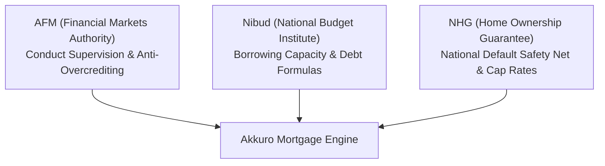

# 01. Business Domain & Regulatory Framework

**System:** Akkuro Mortgage Platform (Loan Origination Subsystem)  
**Standard:** Dutch Residential Mortgage Market (AFM / Nibud / NHG)  
**Author:** Senior Business Analyst  

---

## 1. Executive Summary & Market Context

The Dutch residential mortgage market is characterized by high statutory regulation, multi-stakeholder workflows, and strict consumer protection mandates. Unlike direct-to-consumer banking markets, over **75% of mortgages in the Netherlands** are originated through independent financial intermediaries (*Hypotheekadviseurs*) who package, verify, and submit dossiers to funding lenders (retail banks, pension funds, and insurance syndicates).

The **Akkuro Mortgage Platform** provides a modern, cloud-native Loan Origination System (LOS) that connects intermediaries, lenders, underwriters, and civil-law notaries into a unified, compliance-gated origination pipeline.

---

## 2. Regulatory & Supervisory Framework

Every business rule, validation gate, and data field in this specification adheres to three statutory bodies:

### Statutory Mandates:
1. **AFM (Autoriteit Financiële Markten):**
   - Mandates strict suitability (*Wft - Wet op het financieel toezicht*) and anti-predatory lending rules.
   - Enforces the 14-day statutory reflection period (*Bedenktijd*) once a binding offer is signed.
2. **Nibud (Nationaal Instituut voor Budgetvoorlichting):**
   - Establishes statutory maximum debt-to-income (LTI) tables based on gross household income and interest rates.
   - Prescribes mandatory monthly burden calculations for consumer debts (BKR) and student loans (DUO).
3. **NHG (Nationale Hypotheek Garantie):**
   - State-backed credit risk guarantee operated by *Stichting Waarborgfonds Eigen Woningen (WEW)*.
   - Provides interest rate discounts (typically 20–40 bps) in exchange for adhering to standard loan caps (€435,000 for standard properties in 2024/2025; €461,100 with energy improvements).

---

## 3. Stakeholder Personas & Needs

| Persona | Role | Primary Workflow Need | Pain Point Addressed |
|---|---|---|---|
| **Borrower** (*Klant*) | Consumer applying for financing | Transparent status tracking, digital document upload, fast offer turnaround. | Opaque underwriting stages and repetitive document requests. |
| **Intermediary Advisor** (*Hypotheekadviseur*) | Certified mortgage broker | Multi-scenario loan modeling, automated dossier validation, instant intake routing. | Manual document verification and back-and-forth email loops with underwriters. |
| **Lender Underwriter** (*Acceptant*) | Credit risk decision-maker | Automated statutory compliance gating, auditable risk calculations, one-click offer generation. | Re-keying data between disparate banking systems and manual LTV/NHG validation. |
| **Civil-Law Notary** (*Notaris*) | Legal closing officer | Tamper-proof deed instructions (*Passeeropdracht*), automated fund reconciliation. | Delayed escrow disbursements and unverified last-minute contract amendments. |

---

## 4. Standardized Domain Glossary

| Dutch Term | Standard English Concept | Definition & BA Significance |
|---|---|---|
| **Aanvraag** | Mortgage Application | The core case dossier containing borrower financials, property data, and loan requests. |
| **Taxatiewaarde** | Appraised Market Value | Independent NWWI valuation used as statutory denominator for Loan-to-Value (LTV). |
| **Koopsom** | Purchase Price | Contractual price agreed in the provisional purchase agreement (*Koopovereenkomst*). |
| **LTV** | Loan-to-Value Ratio | Loan principal expressed as percentage of appraised value (max 100% standard, 106% with EBV). |
| **EBV** | Energy-Saving Budget | Additional financing (up to 6% above property value) dedicated strictly to sustainable renovations. |
| **Borgtochtprovisie** | NHG Guarantee Fee | Statutory 0.6% one-time fee paid at notary closing for NHG risk coverage. |
| **Hypotheekvormen** | Mortgage Repayment Types | Annuity (*Annuïteit*), Linear (*Lineair*), or Interest-Only (*Aflossingsvrij* - capped at 50% LTV). |
| **Renteaanbod** | Indicative Rate Offer | Preliminary interest rate proposal locking the rate during document intake. |
| **Definitieve Offerte** | Binding Mortgage Offer | Final legally binding contract issued post-underwriting; triggers 14-day statutory reflection. |
| **Passeerdatum** | Closing / Execution Date | Scheduled legal closing date where the deed is signed and funds are disbursed by the notary. |
