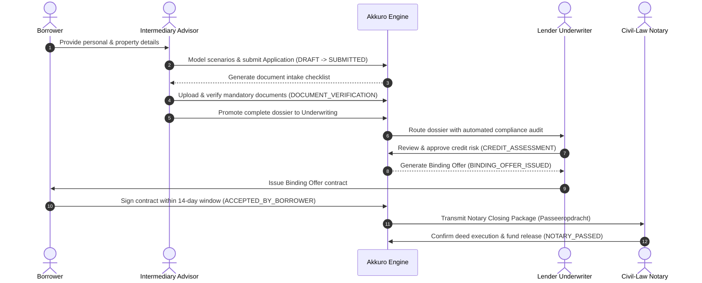
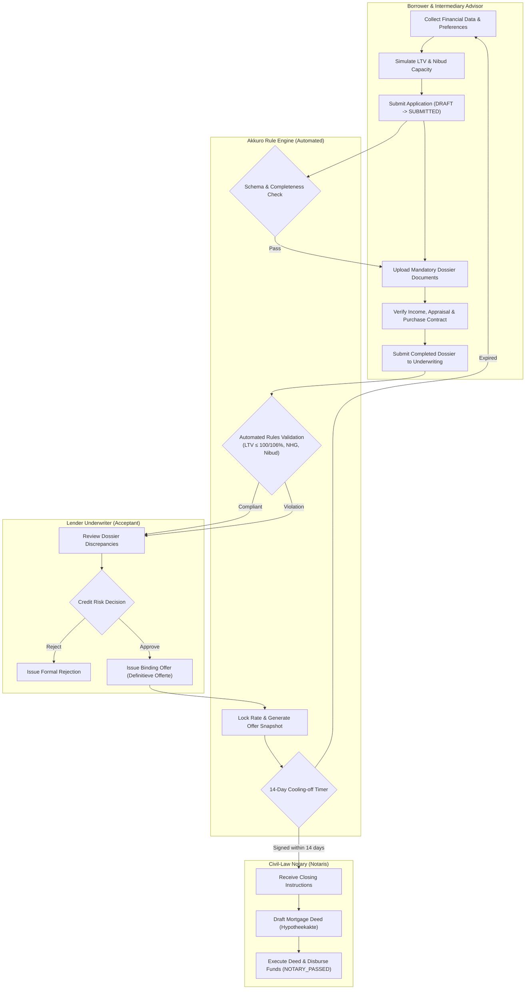

# 02. Process Architecture & Workflow Modeling

**System:** Akkuro Mortgage Platform  
**Model:** BPMN 2.0 Origination Swimlanes & State Transition Matrix  
**Author:** Senior Business Analyst  

---

## 1. Process Overview

The Dutch mortgage origination lifecycle is an asynchronous, multi-actor pipeline spanning from initial borrower consultation to final notary deed execution and fund settlement.

---

## 2. BPMN 2.0 Swimlane Workflow

---

## 3. State Transition Matrix

The table below defines every legal lifecycle status transition in the Akkuro platform. Transitions outside this matrix are rejected by the engine.

| From State | To State | Trigger Event | Allowed Actor(s) | Guard Condition / Validation Gate |
|---|---|---|---|---|
| `DRAFT` | `SUBMITTED` | Submit Application | Borrower, Advisor | All mandatory applicant, income, and property fields populated. |
| `SUBMITTED` | `DOCUMENT_VERIFICATION` | Intake Routing | Advisor, System | Automated schema and initial anti-fraud checks passed. |
| `DOCUMENT_VERIFICATION` | `CREDIT_ASSESSMENT` | Dossier Verified | Advisor | 4 mandatory documents (Employer, UWV, NWWI Appraisal, Purchase Agreement) marked Verified. |
| `CREDIT_ASSESSMENT` | `BINDING_OFFER_ISSUED` | Underwriting Approval | Underwriter | LTV $\le$ cap, requested loan $\le$ Nibud capacity, NHG rules validated. |
| `CREDIT_ASSESSMENT` | `REJECTED` | Underwriting Rejection | Underwriter | Statutory violation or credit risk threshold breached. Reason logged. |
| `BINDING_OFFER_ISSUED` | `ACCEPTED_BY_BORROWER` | Offer Acceptance | Borrower | Digital signature completed within 14-day statutory reflection window. |
| `BINDING_OFFER_ISSUED` | `EXPIRED` | Reflection Timeout | System | Statutory 14-day window lapsed without borrower signature (`BR-OFFER-02`). |
| `ACCEPTED_BY_BORROWER` | `NOTARY_PASSED` | Deed Execution | Notary | Mortgage deed signed and escrow fund release confirmed. |
| *Any Pre-Closing State* | `CANCELLED` | Withdrawal | Borrower, Advisor | Application formally withdrawn by customer prior to deed execution. |

---

## 4. Role-Based Access Control (RBAC) & Four-Eyes Principle

To prevent fraud and maintain regulatory audit trails, critical origination stages enforce strict separation of duties:

| Action | Borrower (*Klant*) | Advisor (*Adviseur*) | Underwriter (*Acceptant*) | Notary (*Notaris*) |
|---|:---:|:---:|:---:|:---:|
| Initiate Application | ✅ Full | ✅ Full | ❌ None | ❌ None |
| Upload & Verify Documents | ⚠️ Upload only | ✅ Verify & Sign-off | 👁️ Audit only | ❌ None |
| Configure Loan Scenarios | 👁️ View quote | ✅ Configure & Model | 👁️ Review | ❌ None |
| Issue Binding Loan Offer | ❌ Forbidden | ❌ Forbidden | ✅ Exclusive | ❌ None |
| Execute Mortgage Deed | ❌ Forbidden | ❌ Forbidden | ❌ Forbidden | ✅ Exclusive |
