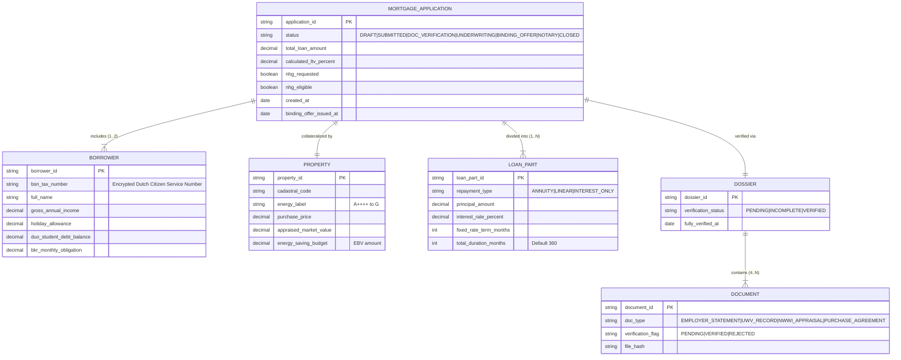

# 04. Data Architecture & Domain Model

**System:** Akkuro Mortgage Platform (Loan Origination System)  
**Standard:** Conceptual Entity-Relationship Model & Standardized Data Dictionary  
**Author:** Senior Business Analyst  

---

## 1. Conceptual Domain Model (ERD)

---

## 2. Standardized Data Dictionary

### Entity 1: `MortgageApplication`
| Field Name | Data Type | Constraints | Description & Business Rule |
|---|---|---|---|
| `application_id` | String (UUID) | Primary Key, Non-null | Unique immutable case dossier identifier. |
| `status` | Enum | Valid State Machine enum | Current lifecycle position (`DRAFT`, `SUBMITTED`, `DOC_VERIFICATION`, `UNDERWRITING`, `BINDING_OFFER`, `NOTARY_PASSED`). |
| `total_loan_amount` | Decimal(12,2) | $> 0$ | Aggregate principal across all linked `LOAN_PART` records. |
| `calculated_ltv_percent` | Decimal(5,2) | Must be $\le 100.0$ (or $106.0$ with EBV) | Computed as $(\text{total\_loan\_amount} / \text{appraised\_market\_value}) \times 100$. |
| `nhg_requested` | Boolean | True / False | Flag set by advisor during scenario configuration. |
| `nhg_eligible` | Boolean | Read-only computed | Evaluated against current statutory cap (€435,000 standard / €461,100 EBV). |
| `created_at` | Timestamp | Non-null | Audit creation timestamp. |
| `binding_offer_issued_at` | Timestamp | Nullable | Timestamp when formal offer is issued; initiates 14-day statutory reflection window. |

### Entity 2: `Borrower`
| Field Name | Data Type | Constraints | Description & Business Rule |
|---|---|---|---|
| `borrower_id` | String (UUID) | Primary Key, Non-null | Unique applicant profile identifier. |
| `bsn_tax_number` | String | AES-256 Encrypted | Dutch Citizen Service Number (*Burgerservicenummer*). Required for BKR credit checks. |
| `full_name` | String | Non-null | Official legal name matching passport / Dutch ID deed. |
| `gross_annual_income` | Decimal(12,2) | $\ge 0$ | Verified annual base compensation from employer statement. |
| `holiday_allowance` | Decimal(12,2) | $\ge 0$ | Statutory 8% holiday payment (*Vakantiegeld*), included in borrowing base. |
| `duo_student_debt_balance` | Decimal(12,2) | $\ge 0$ | Initial registered student loan balance with DUO. |
| `bkr_monthly_obligation` | Decimal(12,2) | $\ge 0$ | Registered consumer credit / private car lease monthly obligation. |

### Entity 3: `Property`
| Field Name | Data Type | Constraints | Description & Business Rule |
|---|---|---|---|
| `property_id` | String (UUID) | Primary Key, Non-null | Unique real estate collateral record. |
| `purchase_price` | Decimal(12,2) | $> 0$ | Contractual price agreed in the provisional purchase deed (*Koopovereenkomst*). |
| `appraised_market_value` | Decimal(12,2) | $> 0$ | Certified valuation by NWWI accredited valuer (*Taxatiewaarde*). Serves as LTV denominator. |
| `energy_saving_budget` | Decimal(12,2) | $\ge 0$ | Budget allocated for sustainable measures (*EBV*). Capped at max 6% of appraisal value. |
| `energy_label` | String | A++++ through G | Statutory EU/Dutch energy performance classification. |

### Entity 4: `LoanPart` (Hypotheekdeel)
| Field Name | Data Type | Constraints | Description & Business Rule |
|---|---|---|---|
| `loan_part_id` | String (UUID) | Primary Key, Non-null | Unique sub-loan split identifier. |
| `repayment_type` | Enum | `ANNUITY`, `LINEAR`, `INTEREST_ONLY` | Amortization mechanics. Interest-Only capped at max 50% of market value. |
| `principal_amount` | Decimal(12,2) | $> 0$ | Principal balance allocated to this specific repayment tranche. |
| `interest_rate_percent` | Decimal(5,3) | $> 0.0$ | Agreed annual nominal interest rate. |
| `fixed_rate_term_months` | Integer | Typically 60, 120, 240, 360 | Fixed-rate lock period (*Rente vaste periode*). |
| `total_duration_months` | Integer | Statutory max 360 (30 yrs) | Full amortization term. |

### Entity 5: `Dossier`
| Field Name | Data Type | Constraints | Description & Business Rule |
|---|---|---|---|
| `dossier_id` | String (UUID) | Primary Key, Non-null | Dossier container grouping all uploaded compliance files. |
| `verification_status` | Enum | `PENDING`, `INCOMPLETE`, `VERIFIED` | Aggregate verification state. Requires all mandatory documents verified. |
| `fully_verified_at` | Timestamp | Nullable | Timestamp of advisor verification sign-off before promoting to Underwriting. |

### Entity 6: `Document`
| Field Name | Data Type | Constraints | Description & Business Rule |
|---|---|---|---|
| `document_id` | String (UUID) | Primary Key, Non-null | Unique individual file record. |
| `doc_type` | Enum | `EMPLOYER_STATEMENT`, `UWV_RECORD`, `NWWI_APPRAISAL`, `PURCHASE_AGREEMENT` | Category of statutory document. |
| `verification_flag` | Enum | `PENDING`, `VERIFIED`, `REJECTED` | Verification outcome assigned by advisor / intake specialist. |
| `file_hash` | String | SHA-256 | Cryptographic integrity hash ensuring document tamper-proofing. |
| `uploaded_at` | Timestamp | Non-null | Upload audit timestamp. |
